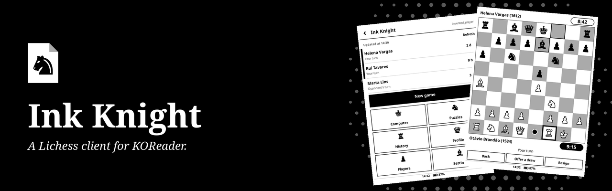
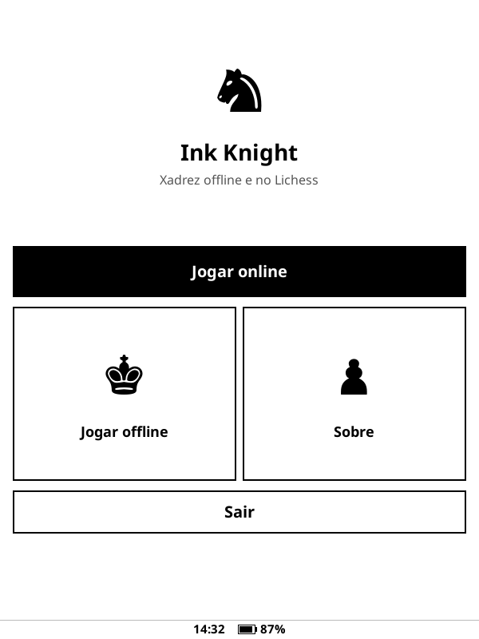
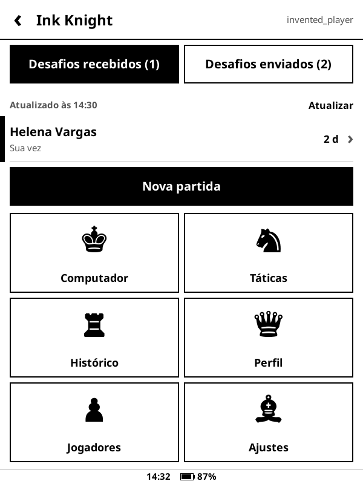
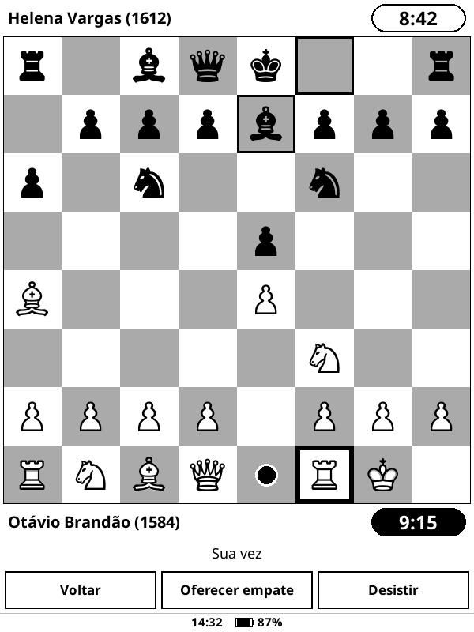
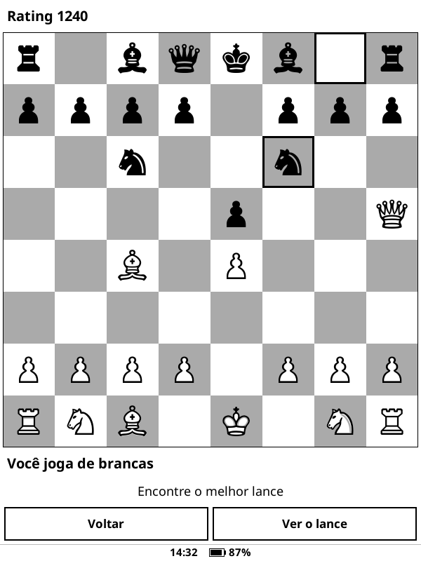
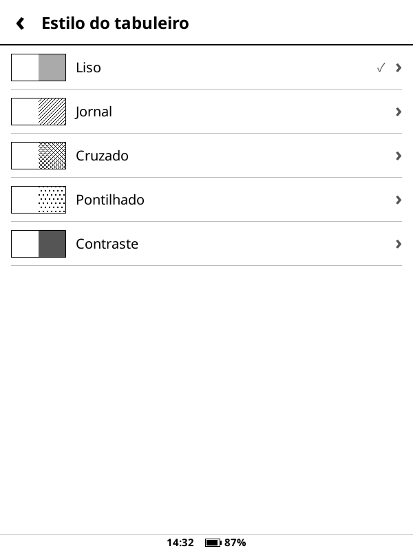
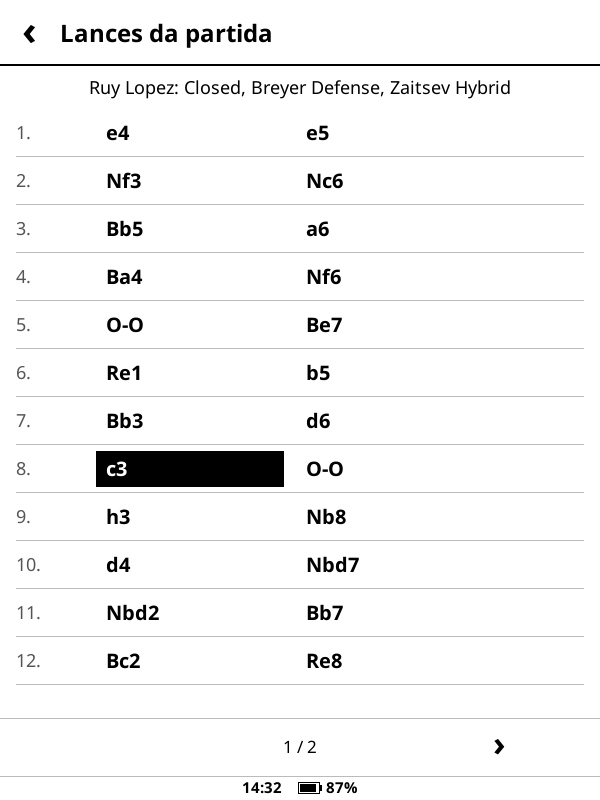
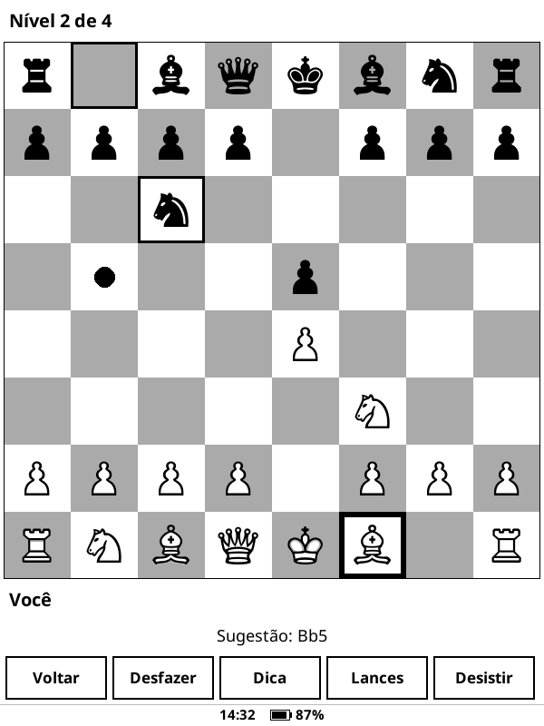
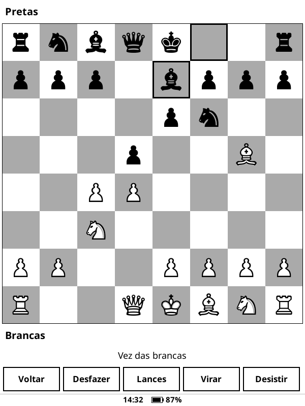

<p align="center">
  
</p>

<p align="center">
  <strong>Um cliente do Lichess para o KOReader. Jogue ao vivo e por correspondência, resolva táticas e reveja suas partidas em e-ink.</strong>
</p>

<p align="center">
  <a href="#o-que-ele-faz">O que ele faz</a> ·
  <a href="#instalação">Instalação</a> ·
  <a href="#conecte-sua-conta">Conecte sua conta</a> ·
  <a href="#o-que-fica-de-fora">O que fica de fora</a> ·
  <a href="#desenvolvimento">Desenvolvimento</a> ·
  <a href="README.md">Read in English</a>
</p>

> [!NOTE]
> O Ink Knight não é um produto oficial do Lichess e não tem vínculo com ele.

## O que ele faz

<table>
  <tr>
    <td width="25%" align="center"><br><sub><b>Primeira tela</b></sub></td>
    <td width="25%" align="center"><br><sub><b>Suas partidas</b></sub></td>
    <td width="25%" align="center"><br><sub><b>Jogando</b></sub></td>
    <td width="25%" align="center"><br><sub><b>Táticas</b></sub></td>
  </tr>
  <tr>
    <td width="25%" align="center"><br><sub><b>Estilos</b></sub></td>
    <td width="25%" align="center"><br><sub><b>Lista de lances</b></sub></td>
    <td width="25%" align="center"><br><sub><b>Dica offline</b></sub></td>
    <td width="25%" align="center"><br><sub><b>Duas pessoas</b></sub></td>
  </tr>
</table>

- **Você escolhe ao abrir:** a primeira tela pergunta se você quer jogar online ou offline, e o Lichess só é contatado se você escolher online. A hora e a bateria ficam na parte de baixo de todas as telas.
- **Jogar:** procure adversário em rapid e clássico, por correspondência, desafie um amigo (também em blitz ou sem limite de tempo) ou jogue contra o computador do Lichess. No desafio, você pode escolher a cor. Os desafios que você enviou ficam ao lado dos recebidos, e dá para cancelá-los.
- **Várias partidas ao mesmo tempo:** a lista mostra de quem é a vez, com as que aguardam você no topo. Ela atualiza no intervalo que você escolher.
- **Durante a partida:** relógios, promoção, pedidos de empate e empate por repetição, pedir para voltar lance, dar tempo, desistir e cancelar. A lista de lances fica a um toque, aqui e nos outros modos, e começa com o nome da abertura, mesmo sem internet (numa partida do Lichess, depois que ela termina). No fim, é só jogar de novo. Uma conexão perdida volta sozinha.
- **Táticas:** um lote fica guardado no aparelho para resolver sem internet, e os resultados vão para o Lichess quando o Wi-Fi voltar. Também tem táticas por tema, seus resultados e a tática do dia, e dá para escolher a dificuldade, comparada ao seu rating de táticas, e a cor com que você joga. Dá também para revisar as táticas que você errou nos últimos 30 dias, inclusive as erradas no site.
- **Rever:** suas partidas anteriores e favoritas, lance a lance, com o que o Lichess sabe de cada posição: a avaliação, os lances mais jogados e, perto do fim, o resultado com jogo perfeito.
- **Jogadores:** busca por nome, quem você segue e está online, perfis, gráfico de rating com estatísticas e o seu histórico contra alguém.
- **Offline:** jogue contra um motor pequeno, que nunca trava a tela, com escolha de cor, desfazer lance e dicas, e continue a partida depois. Ou jogue contra outra pessoa no mesmo aparelho, ou resolva as 5000 táticas que vêm com o plugin, sem precisar de conta, na dificuldade que você escolher. Suas partidas por correspondência também ficam no aparelho: dá para vê-las e fazer o seu lance com o Wi-Fi desligado, e ele vai para o Lichess na próxima vez que você jogar online, se a partida ainda estiver como você deixou.
- **Seu tabuleiro:** cinco estilos de tabuleiro, incluindo as casas hachuradas dos diagramas impressos, três conjuntos de peças e coordenadas nas bordas.
- **Tela de descanso:** se o aparelho dorme com o Ink Knight aberto, aparece a capa do Ink Knight no lugar da capa do livro. Vale quando a tela de descanso do KOReader mostra a capa do livro.

## Instalação

1. Baixe `ink_knight.koplugin.zip` da [última release](https://github.com/beater-studios/ink_knight.koplugin/releases/latest).
2. Extraia em `koreader/plugins/`, de forma que exista `koreader/plugins/ink_knight.koplugin/main.lua`.
3. Reinicie o KOReader. O plugin fica no menu Ferramentas, como **Ink Knight**.

A release tem mais dois pacotes, com o mesmo plugin e mais táticas para resolver sem internet: `ink_knight-20000-puzzles.koplugin.zip` (cerca de 1,2 MB) e `ink_knight-50000-puzzles.koplugin.zip` (cerca de 2,5 MB), contra 5000 táticas no pacote de sempre. Para trocar, extraia outro por cima da pasta instalada; o seu progresso é mantido.

O idioma segue o do KOReader: português, inglês ou espanhol. Em qualquer outro idioma, usa inglês.

As suas opções, as partidas sem internet e os problemas salvos ficam em `koreader/settings/ink_knight.lua`, e o token em `koreader/settings/ink_knight_token` ou, num Kindle, em `/var/local/ink_knight`. Para desinstalar, apague a pasta do plugin e esses arquivos, e revogue o token no Lichess.

## Conecte sua conta

O Ink Knight usa um token pessoal, que só você pode criar e revogar.

1. No Ink Knight, toque em **Conectar conta** e **Criar token no Lichess**. Um QR code abre [a página de criar token](https://lichess.org/account/oauth/token/create) no celular com as permissões marcadas. Sem câmera, ligue na página só estas:
   - Jogo externo: `board:play`, a única necessária para jogar online
   - Interações: `follow:read` e `follow:write`, para quem você segue
   - Problemas: `puzzle:read` e `puzzle:write`
   - Jogar partidas: `challenge:write`, só para dar tempo ao adversário
   - Só para adicionar ou remover favoritos: `preference:write`. Ela vem desmarcada, porque também permite mudar as preferências da conta, o que o Ink Knight nunca faz.
2. Crie o token, copie e toque em **Já criei: colar o token**.
3. Na mesma rede Wi-Fi, aponte o celular para o QR code ou digite em qualquer navegador o endereço que aparece embaixo dele, toque em **Permitir** no leitor e cole o token.

Sem uma permissão, o resto continua funcionando, e o que depende dela avisa o que falta. Em **Configurações > Permissões do token** você vê o que o seu token permite. O Lichess não altera um token existente, então para adicionar uma permissão é preciso criar outro.

> [!WARNING]
> Em um Kindle, o token fica na partição do sistema, fora do alcance pelo USB, onde o Ink Knight o mantém privado. Os serviços do próprio Kindle conseguem acessá-lo depois de reiniciar, até você abrir o Ink Knight. Em outros aparelhos, o Ink Knight confere se o arquivo pode mesmo ser protegido, e avisa quando não pode, porque o armazenamento compartilhado ignora permissões de arquivo. O que roda como root ainda consegue lê-lo, inclusive outros plugins, então, se perder o aparelho ou suspeitar de vazamento, revogue o token no Lichess. Nunca o publique.

<details>
<summary><b>O que protege o seu token</b></summary>

<br>

- **Enviado só ao Lichess**, por HTTPS com o certificado conferido, e mantido em memória durante o uso.
- **A página na sua rede** só existe enquanto aquela tela está aberta, exige um código aleatório no endereço e o seu toque no leitor, atende um só aparelho, só funciona em redes privadas e recusa outros sites. Como um servidor local não tem certificado, use em uma rede de confiança.
- **Só o necessário.** As permissões acima não enviam mensagens privadas, não mudam a sua conta e não leem o seu e-mail.

A lista completa está em [docs/design.md](docs/design.md), em inglês.

</details>

## O que fica de fora

- **Bullet e torneios:** o e-ink é lento demais para eles. O Lichess só permite blitz por desafio direto.
- **Ajuda de motor em partida do Lichess:** é trapaça e pode banir a conta. O motor offline nunca toca em uma partida do Lichess.
- **Bots:** essa API exige transformar a conta em conta de bot.

## Compatibilidade

- Feito para o KOReader 2026.07 e para telas sensíveis ao toque, sempre em retrato. Desenvolvido para um Kindle básico da 10ª geração (firmware 5.18.1).
- Usa só o que vem com o KOReader, sem nada mais para instalar.
- Em uma partida ao vivo, o relógio continua correndo se você sair da tela, então o Ink Knight pergunta antes. Durante uma partida com relógio, o aparelho fica acordado, o que gasta bateria. O botão de ligar continua fazendo ele dormir.

## Desenvolvimento

Com o [LuaJIT](https://luajit.org) e o `zip` instalados, a partir da raiz do repositório, isto roda os testes, confere os textos dos três idiomas e gera o pacote:

```sh
sh tools/check.sh
```

O desenho, as ferramentas e o processo de publicação estão em [docs/design.md](docs/design.md), em inglês. Contribuições são aceitas sob a licença do projeto.

## Licença

[GPL-3.0](LICENSE), somente a versão 3. Você pode usar, estudar, modificar e redistribuir, mantendo aberto sob a mesma licença.

Lichess é marca de seus titulares, e esta licença não concede direitos sobre ela nem sobre os nomes "Ink Knight" e "Beater Studios". Veja o [NOTICE](NOTICE). As peças clássicas são desenhadas com a fonte FreeSerif, que vem com o KOReader, e as peças Cburnett e Merida são de Colin M.L. Burnett e Armando Hernandez Marroquin, sob a GPLv2 ou posterior. Os nomes das aberturas e as táticas incluídas vêm dos dados abertos do Lichess, em domínio público (CC0).

---

<p align="center">
  <sub>Feito por <a href="https://beaterstudios.com/">Beater Studios</a></sub>
</p>
